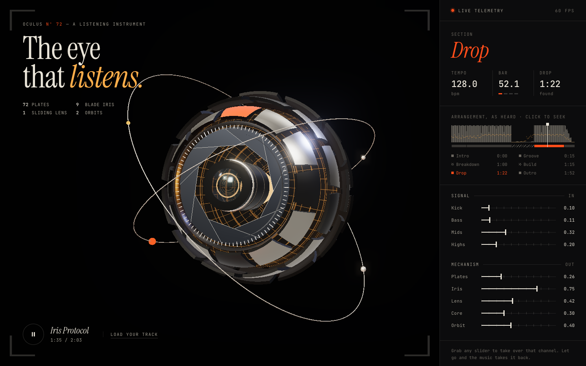
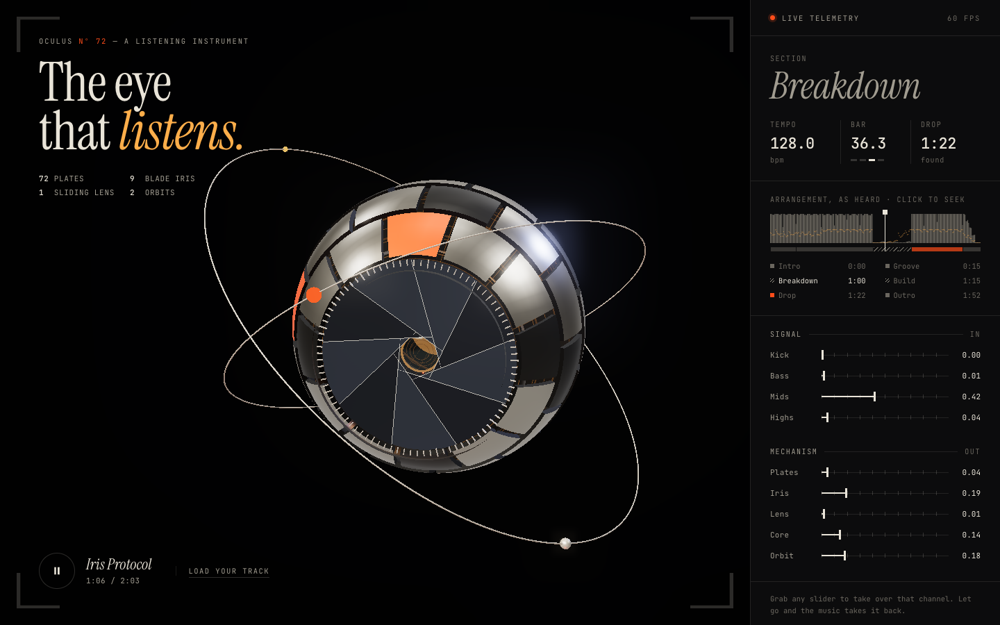

# Auris Nº 72

*A listening instrument.* A mechanical eye that hears the track before it opens.

**▶ Live: https://vfbiby.github.io/auris/** (turn the sound on)



72 plates wrapped around a mechanical eyeball, a 9-blade iris, a lens that slides out when the bass hits, and two rings orbiting it like its own little planet. All 3D, all code, rendered in the browser with Three.js.

## What it does

Before anything moves, Auris analyses the whole track offline:

- **Tempo and beat grid**: onset autocorrelation, then a fine grid fit across the full track (≈0.002 BPM error on the demo).
- **Kicks**: strong low-end onsets that land on the beat grid, so offbeat basslines don't count as kicks.
- **Arrangement**: intro, groove, breakdown (the low end drops away), build (high-hat transients return) and drop (the first kick after the breakdown).

Then the music drives the mechanism:

| Signal | Mechanism |
| --- | --- |
| Kick | plates flip open, ring by ring from front to back |
| Bass | lens pushes out (only once the iris has cleared it) |
| Highs | the inner core and chamber grid light up |
| Breakdown | the eye closes, looks down and goes quiet |
| Build | it trembles |
| Drop | a flash, then it snaps to face you and blows wide open |

The panel on the right is live: every slider moves with the music. Grab one to take over that channel, and let go to hand it back.



## Run

```sh
npm install
npm run dev
```

Open the page and press **Turn the sound on**. A demo track (*Iris Protocol*, 128 BPM, synthesised in the browser) loads by default. Use **Load your track** to analyse your own audio file.

## Layout

- `src/synth.js`: renders the demo track with `OfflineAudioContext`
- `src/analyze.js`: band envelopes, tempo, kicks and sections
- `src/eye.js`: the Three.js model and post-processing
- `src/main.js`: the director (music to mechanism), panel and transport
- `scripts/shoot.mjs`: Playwright screenshots of each section for visual checks
